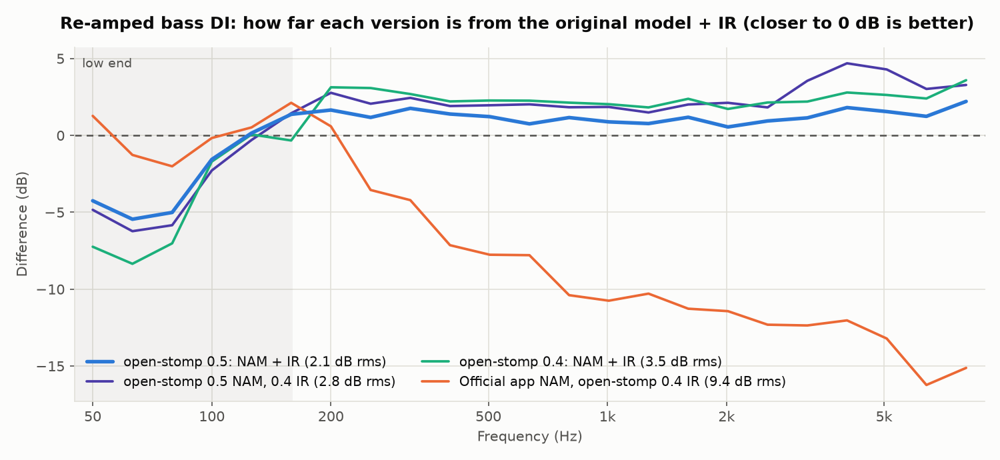

# open-stomp

**An open-source library for the SORAN Dual Stomp Lite guitar pedal.**

[](https://github.com/JackMechem/open-stomp-lib/actions/workflows/ci.yml)
[](https://github.com/JackMechem/open-stomp-lib/releases)
[](https://jackmechem.github.io/open-stomp-lib/)
[](#license)

Version **0.6.1** · Rust and Python · Linux, macOS, Windows ·
[Documentation](https://jackmechem.github.io/open-stomp-lib/) · [Changelog](CHANGELOG.md)

`open-stomp` speaks the pedal's USB-MIDI and Bluetooth MIDI protocol, which was reverse engineered from the
vendor's *Stomp Manager* app. It reads and edits presets, follows everything happening on the pedal, and imports
NAM amp models and cab IRs with conversions that sound closer to the original than the official app's. This
repository also holds the full protocol documentation.

The desktop editor [Open Stomp Manager](https://github.com/JackMechem/open-stomp-manager) is built on it.

> **Compatibility.** Tested on the Dual Stomp Lite, firmware V1.1.1. The Dual Stomp and Tiny Stomp share the
> firmware family and probably work too. Reports from owners are welcome.

## Features

- **Full protocol:** parse and build every message the official app sends or receives: live CC/PC control,
  vendor SysEx, and the packed preset and settings records.
- **State tracking:** `DeviceState` follows all 99 presets, the live sound, looper, drum machine, tuner, settings
  and user slots, and describes each message in plain English (`AMP · Mar J800 · GAIN = 64`).
- **Connection engine:** finds the pedal, connects, follows hotplug, runs the startup sync and paces requests the
  way the pedal needs. Works over USB and Bluetooth LE.
- **NAM and IR import:** converts `.nam` models and WAV cab IRs for the pedal's user slots
  ([results](#nam-and-ir-conversion)).
- **Develop without a pedal:** replay recorded sessions through the real engine.
- **Python bindings:** the same library from Python, fully typed.

The protocol layer has no I/O and no dependencies, so it can be used with any MIDI transport.

## Installation

The crate isn't on crates.io yet. Add it from GitHub:

```toml
[dependencies]
open-stomp = { git = "https://github.com/JackMechem/open-stomp-lib", tag = "v0.6.1" }
```

To follow releases instead of pinning one, use `branch = "stable"` (newest release) or `branch = "unstable"`
(newest release or pre-release); `cargo update` then moves you forward.

For Python ≥ 3.9, download the wheel for your platform from
[Releases](https://github.com/JackMechem/open-stomp-lib/releases) and `pip install` it, or build from a checkout:

```sh
pip install ./bindings/python
```

**Requirements:** Rust 1.88 or newer. On Linux, install the ALSA and D-Bus headers
(`libasound2-dev libdbus-1-dev` on Debian/Ubuntu, `alsa-lib-devel dbus-devel` on Fedora). macOS and Windows need
nothing extra. The pedal is class compliant, so no driver is needed on any OS.

| Feature | Default | Adds |
|---|---|---|
| `device` | ✓ | The connection engine (MIDI through [`midir`](https://crates.io/crates/midir)) |
| `ble` | ✓ | Bluetooth LE MIDI ([`btleplug`](https://crates.io/crates/btleplug)) |
| `nam` | ✓ | NAM model loading, inference and conversion; optimised IR conversion |

`default-features = false` gives the protocol layer alone.

## Quick start

```rust
use open_stomp::device::{Config, Device, Update};
use open_stomp::{DeviceState, Module};

let dev = Device::spawn(Config::default()); // finds and connects to the pedal by itself

// Change the live sound (nothing is stored until you save):
dev.select_preset(4);                        // P05
dev.set_head(Module::Amp, 8, true);          // AMP on, model 8 (Mar J800)
dev.set_param(Module::Amp, 0, 100);          // GAIN = 100

// Print everything that happens on the pedal:
let mut state = DeviceState::default();
while let Ok(update) = dev.recv() {
    match update {
        Update::Reset => state = DeviceState::default(),
        Update::Message { origin, bytes, .. } => {
            let ev = state.apply(&bytes, origin);
            println!("{:8} {} = {}", ev.category.label(), ev.subject, ev.value);
        }
        _ => {}
    }
}
```

The same in Python:

```python
from open_stomp import Device, DeviceState

state = DeviceState()
with Device() as dev:
    for update in dev:
        if ev := state.feed(update):
            print(ev)                        # AMP      Mar J800 · GAIN = 64
```

No pedal? Replay a recorded session:

```sh
git clone https://github.com/JackMechem/open-stomp-lib && cd open-stomp-lib
cargo run --example monitor -- --replay captures/logs/01-main-session.log --speed 8
```

With a pedal plugged in, run `cargo run --example monitor` (add `--listen` to never send anything).

## NAM and IR conversion

The pedal can't run a neural network. Each user amp slot holds two 512-tap filters with a fixed saturation curve
between them, and each cab slot plays only the first 384 samples of an IR. Every import is an approximation.

open-stomp fits those filters to the original through a measured simulation of the pedal, instead of copying the
official app's approach. The official app's algorithm is also available, reproduced exactly.



A bass DI re-amped through the pedal, compared with the original model and IR in software (rms error; lower is
better):

| | Official app | open-stomp |
|---|---|---|
| Overall tone (40 Hz–10 kHz) | 9.4 dB | **2.1 dB** |
| Low end (40–160 Hz) | 3.0 dB | 3.3 dB |
| Closest to the original | 8% of the recording | **87%** |

Cab IRs improve the same way: 2.1–5.2 dB rms from the full IR, against 5.3–16.1 dB for the official upload.
See the [measurements on hardware](https://jackmechem.github.io/open-stomp-lib/analysis/results.html) and the
[interactive comparison](https://jackmechem.github.io/open-stomp-lib/analysis/session2.html).

## Status

| | |
|---|---|
| Live control, state tracking, startup sync | Verified on hardware (USB and Bluetooth) |
| NAM and IR import (optimised and official) | Verified on hardware |
| Preset save/rename, settings writes | Byte-identical to the official app; not yet run on hardware |
| LSTM / ConvNet NAM models | Not supported yet |

Writing bad data to a pedal could corrupt presets. Back them up before trying preset or settings writes.

## Documentation

The [documentation site](https://jackmechem.github.io/open-stomp-lib/) has everything below, plus install guides,
the app's docs and the API reference (`cargo doc --open` builds it locally).

**Using the library**

- [Library guide (Rust)](docs/10-library-guide.md): the engine, state, editing, saving, imports, testing
- [Python guide](docs/11-python-guide.md): the same API from `import open_stomp`

**The protocol**

| | |
|---|---|
| [01 Overview](docs/01-overview.md) | Hardware, USB interfaces, protocol summary |
| [02 MIDI CC reference](docs/02-midi-cc-reference.md) | Every CC and program change: modules, models, parameters |
| [03 SysEx protocol](docs/03-sysex-protocol.md) | Framing, command table, handshake, encodings |
| [04 Data structures](docs/04-data-structures.md) | Preset, settings, slot, looper, drum and tuner records |
| [05 NAM and IR uploads](docs/05-uploads-nam-ir.md) | Upload transport and both conversions |
| [06 Rust and Linux guide](docs/06-rust-linux-guide.md) | Talking to the pedal from a shell or your own code |
| [07 Capture methodology](docs/07-capture-methodology.md) | How the traffic was recorded, and how to record more |
| [08 Static analysis](docs/08-static-analysis.md) | What the vendor app and firmware revealed |
| [09 Open questions](docs/09-open-questions.md) | What's still unknown |

## Contributing

Contributions are welcome, from bug reports and captures from other pedals to code and docs. See
[CONTRIBUTING.md](CONTRIBUTING.md) for setup, tests and how to send a change.

## License

Licensed under either of [Apache License 2.0](LICENSE-APACHE) or [MIT](LICENSE-MIT), at your option. Unless you
state otherwise, any contribution you submit is dual-licensed the same way, without additional terms.

The NeuralAmpModelerCore example models in `tests/data/nam` are MIT-licensed by their authors.

## Disclaimer

open-stomp is an independent interoperability project. It is not affiliated with or endorsed by SORAN, NUX/Cherub
or JiYou; product names are trademarks of their owners. This repository contains no vendor binaries or firmware.
Use it at your own risk.
