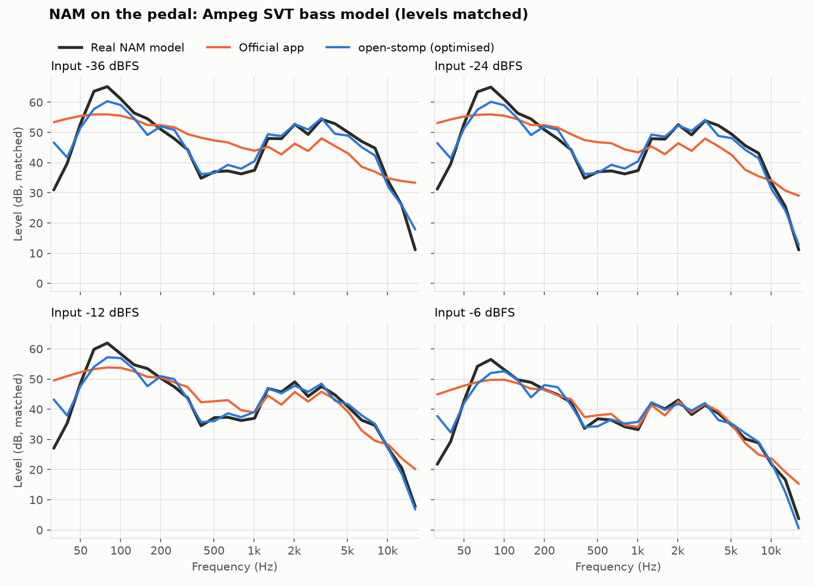
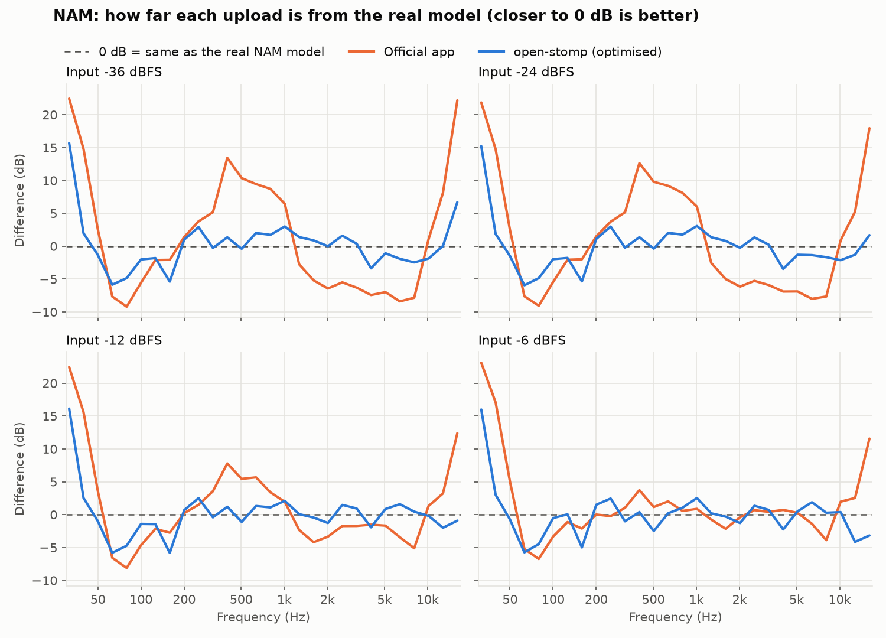
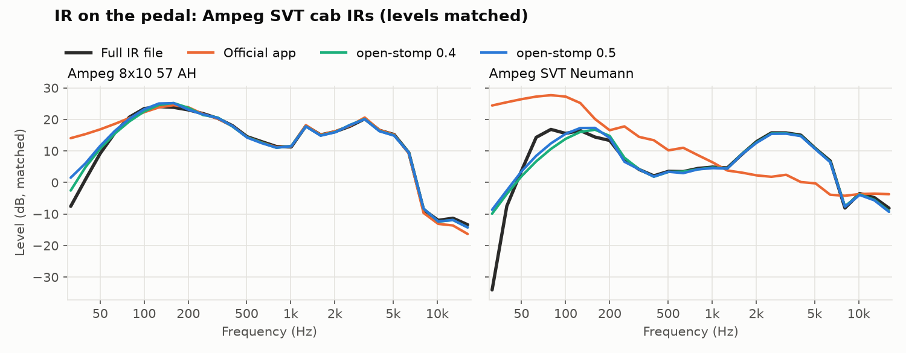
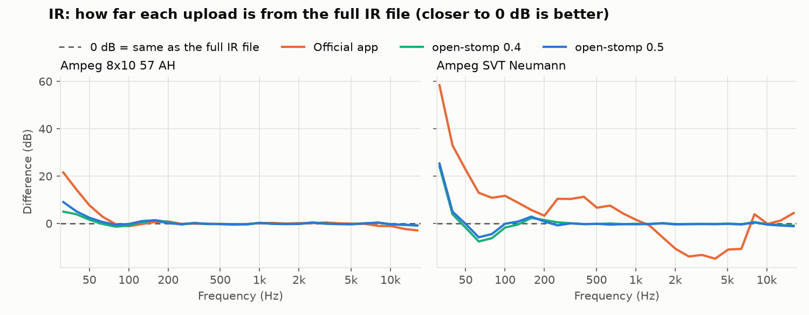

# open-stomp

A Rust library for the SORAN Dual Stomp Lite guitar pedal ·
Version **0.5.1** · Linux · macOS · Windows · [documentation](https://jackmechem.github.io/open-stomp-lib/) · [changelog](CHANGELOG.md)

`open-stomp` talks to the **SORAN Dual Stomp Lite** guitar multi-effects pedal (USB `3962:2000`, "JME STOMPBOX")
over USB-MIDI. It implements the protocol reverse engineered from the vendor's *Stomp Manager* app, and this repo
documents that protocol in full. [Open Stomp Manager](https://github.com/JackMechem/open-stomp-manager), the open
cross-platform editor, is built on it.

> Probably also applies to the Dual Stomp and Tiny Stomp (same firmware family, same app). Only the Dual Stomp Lite on
> firmware **V1.1.1** with Stomp Manager **1.0.2** has been tested.

## What it does

* **Parse and build every message**: live CC/PC control, vendor SysEx frames, the 8-in-7 packed records, request
  and command builders for everything the official app sends.
* **Track the pedal's state**: `DeviceState` applies traffic in either direction and keeps the 99 presets, the live
  edit buffer, the active preset, looper, drum, tuner, settings and user NAM/IR slot names. It also describes each
  message in plain English (`AMP · Mar J800 · GAIN = 64`).
* **Encode presets and settings** for writing, keeping unknown bytes intact. Tested byte for byte against the
  official app's captured writes.
* **Pace requests** the way the pedal needs: one SysEx in flight, reply matching, timeouts (`RequestQueue`, pure).
* **Import NAM amp models** (feature `nam`): load and run `.nam` files (a Rust port of NeuralAmpModelerCore) and
  convert them for the pedal with an optimiser that fits the pedal's filters to the model through a simulation of
  the pedal (`Device::import_nam_file`; closer to the model than the official app), or with the official app's
  algorithm, reverse engineered. Imports are normalised to the built-in amps' level, like NAM plugins do.
* **Import cab IRs**: read any WAV and fit it to the 384 samples the pedal actually plays
  (`Device::import_ir_file`), or convert it exactly like the official app.
* **Run the connection** (feature `device`): find the pedal, connect, follow hotplug, perform the official app's
  startup sync, send edits, report everything. It can also replay a capture log so you can develop without a pedal.
* **Wireless** (feature `ble`): the same over Bluetooth LE MIDI, with no pairing; the pedal shows up as
  `"JME STOMPBOX (Bluetooth)"`.

The protocol layer has no I/O and no dependencies. The device layer uses [`midir`](https://crates.io/crates/midir)
(ALSA, CoreMIDI, WinMM); the NAM layer uses `serde_json` and `rustfft`.

## Quick start

```toml
[dependencies]
open-stomp = { git = "https://github.com/JackMechem/open-stomp-lib", tag = "v0.5.1" }
```

```rust
use open_stomp::device::{Config, Device, Update};
use open_stomp::{DeviceState, Module};

let dev = Device::spawn(Config::default()); // finds and connects to the pedal by itself
let mut state = DeviceState::default();
while let Ok(update) = dev.recv() {
    match update {
        Update::Reset => state = DeviceState::default(),
        Update::Message { origin, bytes, .. } => {
            let ev = state.apply(&bytes, origin);
            println!("{:8} {} = {}", ev.category.label(), ev.subject, ev.value);
        }
        _ => {}
    }
}

// control it (the pedal's live sound; nothing is stored until you save):
dev.select_preset(4);                    // P05
dev.set_head(Module::Amp, 8, true);      // AMP on, model 8 (Mar J800)
dev.set_param(Module::Amp, 0, 100);      // GAIN 100
```

From **Python** (same library, compiled in with PyO3; see the [Python guide](docs/11-python-guide.md)):

```sh
pip install ./bindings/python
```

```python
from open_stomp import Device, DeviceState

state = DeviceState()
with Device() as dev:
    for u in dev:
        if ev := state.feed(u):
            print(ev)                    # AMP      Mar J800 · GAIN = 64
```

Without the pedal:

```sh
cargo run --example monitor -- --replay captures/logs/01-main-session.log --speed 8
cargo run --example decode -- captures/logs/01-main-session.log
```

With it: `cargo run --example monitor` (add `--listen` to send nothing), `cargo run --example ports`.

The [library guide](docs/10-library-guide.md) covers the engine, state tracking, saving presets, settings, the
catalogue, using your own MIDI transport, replay and testing. `cargo doc --open` has the API reference.

## The protocol in brief

* The pedal is a **class-compliant USB Audio 2.0 + USB-MIDI** device. No driver, no libusb, on any OS.
* **Live control is plain MIDI.** The pedal reports on **channel 1** and you command it on **channel 2** with the
  **same CC numbers**. Values are the 0–100 numbers the app shows. Each module has a head CC
  `(off ? 0x40 : 0) | model`.
  ```
  C1 04        -> select preset P05
  B1 01 40     -> amp OFF (model 0)        B1 01 08 -> amp ON, model 8 (Mar J800)
  B1 12 64     -> amp GAIN = 100
  B1 44 01     -> looper REC/PLAY/DUB
  ```
* **Bulk data** (presets, names, settings, looper/drum/tuner records, NAM/IR uploads) uses vendor SysEx
  `F0 00 21 7A 70 <cmd> <dir> … F7` (read/write/reply/ack), strictly request → response. Big records are 8-bit
  structs packed into a 7-bit little-endian bitstream.

Try it from a Linux shell:

```sh
amidi -l                                            # find "JME STOMPBOX", e.g. hw:2,0,0
amidi -p hw:2,0,0 -S 'F0 00 21 7A 00 F7' -d -t 1    # -> F0 00 21 7A 10 56 31 2E 31 2E 31 ... ("V1.1.1")
amidi -p hw:2,0,0 -d                                # turn knobs on the pedal and watch the CCs
```

## NAM conversion: closer to the real model than the official app

The pedal can't run a NAM network. It runs two 512-tap filters with a fixed saturation curve between them
(`G2 ⊛ f(G1 ⊛ x)`), so every import is an approximation. The official app designs the two filters from two
measurements of the model. open-stomp instead simulates the pedal (a model fitted from re-amp recordings) and
optimises the filters until the simulated pedal sounds like the model. This is the default for
`Device::import_nam_file`; it takes about a minute per model.

**Real playing.** A bass DI re-amped through the pedal with the Ampeg SVT-VR Classic (Normal) model and a cab IR,
compared with the model and the full IR in software on exactly what the pedal heard (loudness-matched, rms dB; lower
is better):


| | Official app | open-stomp 0.4 | open-stomp 0.5 |
|---|---|---|---|
| Overall tone (40 Hz–10 kHz) | 9.4 dB | 3.5 dB | **2.1 dB** |
| Low end (40–160 Hz) | 3.0 dB | 5.2 dB | **3.3 dB** |
| Moment to moment (median) | 6.2 dB | 4.3 dB | **3.0 dB** |
| Closest to the original | 8% | 2% | **87%** of the recording |

**[Open the interactive comparison](https://jackmechem.github.io/open-stomp-lib/analysis/session2.html)** for the
spectra, the error over time and a time × frequency heatmap, or read
[how the low end was fixed](https://jackmechem.github.io/open-stomp-lib/analysis/low-end.html).

**Sweeps and tones.** The Ampeg SVT "Gain 10 Ultra Lo and Hi" model converted three ways and re-amped in one
session (sweeps at four levels, bass tones; rms dB against the model in software, levels matched; lower is better):

| Upload | Frequency response | Low end (40–160 Hz) | Note dynamics | Harmonics |
|---|---|---|---|---|
| Official app | 4.75 dB | 4.95 dB | 9.34 dB | 12.16 dB |
| open-stomp 0.4 | 3.05 dB | 5.35 dB | 5.84 dB | 10.85 dB |
| open-stomp 0.5 | **2.14 dB** | **3.51 dB** | **2.88 dB** | **8.60 dB** |





The graphs compare tone, so each upload is level-matched to the model over 100 Hz–8 kHz. Level is set separately: by
default an import is normalised to the built-in amps' level. The official conversion is off by up to 10–13 dB in the
400 Hz–1 kHz mids at low input levels, 5–8 dB in the upper mids and up to 20 dB in the top octave (6.3–9.0 dB rms per
sweep). Both open-stomp versions stay within 4 dB from 100 Hz to 10 kHz; 0.5 is closer overall (3.6–4.0 dB rms per
sweep, which includes the sub-bass below 50 Hz; 0.4: 4.1–4.7). Below 100 Hz this model has a +20 dB resonance above a
steep cut that 512 taps can't fully follow: at 63–80 Hz 0.5 is 4–8 dB short of it, 0.4 7.5–10 dB. Details:
[docs/05](docs/05-uploads-nam-ir.md#optimised-conversion).

## IR conversion: closer to the real cab than the official app

The pedal plays only the first 384 taps (8 ms) of a user IR. The official app uploads the start of the file as it
is, cut off at that point, so it loses whatever comes later. That includes the whole IR when the file starts with
silence. open-stomp designs a 384-tap minimum-phase filter fitted to the full IR's response instead. This is the
default for `Device::import_ir_file`; it takes about half a second.

Re-amped through the pedal in one session and compared with the full IR file in software (two Ampeg SVT cab IRs,
levels matched, 31.5 Hz–16 kHz):





| IR | Official app | open-stomp 0.4 | open-stomp 0.5 |
|---|---|---|---|
| Ampeg 8x10 57 AH | 5.28 dB rms | **1.36 dB rms** | 2.11 dB rms |
| Ampeg SVT Neumann | 16.13 dB rms, and 45 dB quieter | **5.13 dB rms** | 5.23 dB rms |

The SVT Neumann file starts with 21 ms of silence, so the official upload plays almost none of the cab. Every upload
has too much energy below 50 Hz, where the cab rolls off more steeply than 8 ms can follow. 0.5's fit starts at
30 Hz instead of 25 Hz: on the pedal that helps at 50–100 Hz on the Neumann (up to 1.8 dB closer) but costs 1–4 dB
in the 32–40 Hz bands, below a bass's low E, which is where these two scores lose. Details:
[docs/05](docs/05-uploads-nam-ir.md).

The analysis code is in [`tools/pedalsim`](tools/pedalsim): `readme_plots.py <session>` measures a re-amp session and
redraws these graphs (`--cached` redraws from `tools/pedalsim/results`), and
[`reamp_compare`](tools/pedalsim/reamp_compare) builds the real-playing comparison.

## Status

| Area | Protocol | In the library |
|---|---|---|
| Device identification, handshake | ✅ decoded | ✅ `req::`, `queue::handshake`, engine sync |
| Every effect module / model / parameter ↔ CC (both directions) | ✅ all 8 modules | ✅ `catalog`, `host::head/param` |
| Preset select, delta CC dumps | ✅ | ✅ |
| Looper, drum, tuner | ✅ | ✅ state + `host::` commands |
| Preset record (110 B) | ✅ layout from 99 presets (some bytes unknown) | ✅ decode + encode, unknown bytes kept |
| Preset rename / save-as | ✅ sequence captured | ✅ `host::save_preset`, byte-exact vs capture |
| System settings | ✅ (some bytes unknown) | ✅ decode + encode |
| User AMP (NAM) / user IR upload transport | ✅ chunk protocol decoded | ✅ `upload`, byte-exact vs capture |
| NAM inference and NAM → device conversion | ✅ algorithm recovered ([docs/05](docs/05-uploads-nam-ir.md)) | ✅ `nam`, verified against the app; optimised conversion verified on hardware |
| IR (audio) → device conversion | ✅ algorithm recovered ([docs/05](docs/05-uploads-nam-ir.md)) | ✅ `ir`, `Device::import_ir_file`, byte-exact vs the app; optimised conversion verified on hardware |

Live CCs are verified on hardware. Preset and settings **writes** match the official app byte for byte but have not
yet been run on hardware from this code. Back up your presets first.

## Documentation

**The [documentation site](https://jackmechem.github.io/open-stomp-lib/)** has everything below plus install guides, the app's docs, the NAM / IR
analysis with interactive graphs, and the API reference. It is built from `site/` and the docs here.

This repository is the home of the protocol and reverse-engineering documentation. The app's own docs (user guide,
building, architecture) are in [open-stomp-manager](https://github.com/JackMechem/open-stomp-manager).

| | |
|---|---|
| [01 Overview](docs/01-overview.md) | Hardware, USB interfaces, protocol summary, app architecture |
| [02 MIDI CC reference](docs/02-midi-cc-reference.md) | **Every CC/PC**: all models and params, looper, drum, tuner |
| [03 SysEx protocol](docs/03-sysex-protocol.md) | Framing, command table, handshake, encodings, captured write sequences |
| [04 Data structures](docs/04-data-structures.md) | Preset, settings, IR/NAM slot, drum/loop/tuner records |
| [05 NAM & IR uploads](docs/05-uploads-nam-ir.md) | Upload transport and what's known about the conversion |
| [06 Rust/Linux guide](docs/06-rust-linux-guide.md) | Crates, architecture, protocol code in isolation, roadmap |
| [07 Capture methodology](docs/07-capture-methodology.md) | How it was sniffed on macOS and how to make new captures |
| [08 Static analysis](docs/08-static-analysis.md) | App binary (Flutter/Dart AOT), native libs, firmware notes |
| [09 Open questions](docs/09-open-questions.md) | What's left and how to find out |
| [10 Library guide](docs/10-library-guide.md) | **Using this crate**: engine, state, editing, saving, recipes, testing |
| [11 Python guide](docs/11-python-guide.md) | **Using it from Python**: the same API through `import open_stomp` |

## Development

```sh
cargo test                         # unit tests + tests driven by captures/logs
cargo test --no-default-features   # protocol layer only
cargo clippy --all-targets -- -D warnings
cargo doc --open
nix develop                        # optional dev shell: cargo, rust-analyzer, ALSA, amidi
cd bindings/python && maturin develop && pytest   # Python bindings (pip install maturin pytest)
```

Rust ≥ 1.88. On Linux the `device` feature needs the ALSA headers (`libasound2-dev` / `alsa-lib-devel`), and `ble` the
D-Bus headers (`libdbus-1-dev` / `dbus-devel`). CI runs on
Linux, macOS and Windows.

### Versioning and releases

[SemVer](https://semver.org) (0.x: anything may change). The version lives in one place, `version` in `Cargo.toml`.
To release:

1. Bump `Cargo.toml`, add a `## [x.y.z]` section to [CHANGELOG.md](CHANGELOG.md), update the version line at the top
   of this README and the `tag = "vx.y.z"` in the quick start, and run `cargo build` so `Cargo.lock` follows.
   `scripts/check-version.sh` checks all of this (CI runs it too).
2. Commit, then `git tag vx.y.z && git push --tags`. The release workflow tests the tag and publishes a GitHub
   release with the changelog section as its notes.
3. Point dependents at the new tag (Open Stomp Manager: `OPEN_STOMP_LIB_REF` in its workflows).

## Repository layout

```
src/              the library (see docs/10 for the module map)
bindings/python/  Python bindings (PyO3 + maturin): Rust glue, typed package, tests, examples
examples/         monitor (live / replay), decode (capture → text), ports (list MIDI ports),
                  nam_convert / nam_optimise / nam_render / nam_check (NAM conversion, inference, comparisons)
tests/            capture-driven integration tests (fake pedal, engine replay), NAM inference vs
                  NeuralAmpModelerCore (tests/data/nam: its MIT example models + reference outputs)
captures/logs/    capture logs of the official app and the pedal: the test vectors
docs/             the protocol documentation and the library guide
site/             the documentation site (mdBook; site/assemble.py pulls in both repos' docs)
tools/pedalsim/   the analysis behind the optimised NAM conversion (Python): re-amp rig, pedal
                  simulator, PyTorch prototype of the optimiser, scoring, README graphs
project.md        project notes and roadmap
```

The capture/decoding tools and static-analysis artefacts that produced the docs live in the
[open-stomp-manager](https://github.com/JackMechem/open-stomp-manager) repository.

## Legal

This is an independent interoperability project. It is not affiliated with or endorsed by SORAN, NUX/Cherub or
JiYou. Product names are trademarks of their owners. The repo contains **no vendor binaries or firmware**: only
documentation, our own code, and captures of traffic between the author's own pedal and app. Use at your own risk:
writing bad data to a pedal could corrupt presets. Back them up first.

## License

TBD by the repository owner. MIT/Apache-2.0 is suggested for the code and CC-BY-4.0 for the docs.
